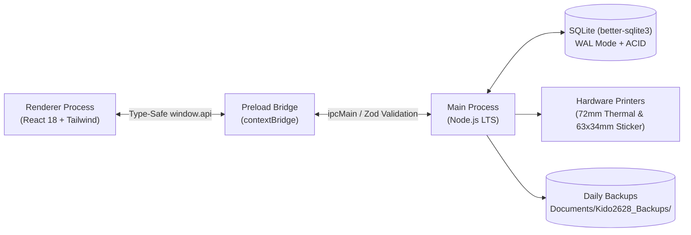

# KIDO 2628 · 基多 Retail POS & Inventory Management System

[](src/main/__tests__/verify-domain.ts)
[](tsconfig.json)
[](package.json)
[](src/main/db/database.ts)
[](src/renderer/src/main.tsx)
[](tailwind.config.js)
[](#)

A modern, production-grade, offline-first Desktop Point of Sale (POS) and Multi-Variant Inventory Management system engineered for children's fashion retail (**KIDO 2628 · 基多**, imported Korean kids wear).

Rebuilt from the ground up to replace legacy single-file browser `localStorage` systems with local embedded **SQLite**, **ACID transactions**, **type-safe IPC**, and **silent thermal receipt & barcode label printing**.

---

## Key Features

### 🛒 High-Speed POS Counter Billing (`F1`)
- **Instant Scan-to-Cart**: Hardware barcode scanner support with burst buffer listener (<60ms) and automatic modal variant picker.
- **100% Keyboard Operable**: `F1`–`F8` navigation, `Enter` to commit tender, and focus-preserving inline quantity/discount adjustments.
- **Dynamic Digital Payments**: On-screen dynamic **UPI BharatQR** generation for instant customer smartphone scanning.
- **Atomic Save & Print**: A single action atomically commits invoice, deducts variant stock, records audit logs, updates register till, and dispatches silent print.

### 👗 Multi-Variant Product Catalog (`F2`)
- **Size & Colour Matrix**: Shared article master SKU across multiple sizes (`2Y, 3Y, 4Y`) and colours (`Pink, Blue`) with independent variant stock tracking.
- **One-Click Combinations**: Built-in matrix generator creates dozens of SKU variants in seconds.
- **Deletion Safeguards**: Strict blocking if active inventory remains or if historical sales/purchases/returns are attached.
- **Barcode Label Batch Printer**: Precision 63mm × 34mm sticky label generator with pure SVG Code-128 barcodes (no canvas blur).

### 📦 Inward Purchases & Fast Stock Intake (`F4`)
- **Supplier Orders**: Log inwards by supplier, update variant inventory, and track supplier payables.
- **Fast Barcode Stock In**: Scanner-driven rapid intake modal for counter stock arrival.
- **True Weighted Cost**: Automatic weighted-average Cost of Goods Sold (COGS) tracking across total catalog inventory.

### 🔄 Returns & Exchanges with Discount Proration (`F5`)
- **Invoice Verification**: Entering an invoice auto-loads sold items, original unit rates, and remaining eligible quantities.
- **Discount Proration**: Returns on bills with bill-level discounts automatically prorate unit refunds, guaranteeing the store never refunds more than the customer paid.
- **Restock vs Defective Toggle**: Restock directly into inventory or log as damaged/defective scrap.
- **Clerical Error Voiding**: Void mislogged returns with automatic inventory reversal and shift isolation.

### 💵 Register Shifts & Cash Till Reconciliation (`F6`)
- **Daily Shift Tracking**: Capture opening cash float, live cash sales, cash refunds, and expected till balance.
- **Reconciliation Audit**: Compare physical counted cash with system expected cash; tracks surplus (+), balanced, or deficit (-).
- **Financial KPIs**: Real Net Sales ($\text{Gross} - \text{Returns}$) and Net Profit ($(\text{Sales} - \text{COGS}) - \text{Returns}$).

### 🔒 Enterprise Security & Data Portability (`F7`)
- **Hardened Electron Sandbox**: `contextIsolation: true`, `sandbox: true`, strict CSP headers, protocol lockdown on `shell.openExternal`.
- **Zod Request Validation**: Every IPC channel validates input payloads before database execution.
- **Formula Injection Defense**: Excel and CSV exports sanitized against CWE-1236.
- **Automated Daily Backups**: Daily background SQLite snapshot saved to `Documents/Kido2628_Backups/`.
- **Full Portability**: One-click JSON backup/restore (fully backwards-compatible with legacy v1.40 JSON) and `.sqlite` binary transfer.

---

## Keyboard Shortcuts

| Key | Section | Action |
| :---: | :--- | :--- |
| **`F1`** | **Point of Sale** | Navigate to POS; if on POS, prompts to clear cart for a New Bill |
| **`F2`** | **Products** | Open Multi-Variant Catalog & Label Printer |
| **`F3`** | **Reports** | Open Sales Register, KPIs & Excel Export |
| **`F4`** | **Purchases** | Open Supplier Inward Purchase Orders |
| **`F5`** | **Returns** | Open Returns & Exchanges Log |
| **`F6`** | **Shifts** | Open Cash Till Reconciliation & Opening Float |
| **`F7`** | **Settings** | Open Hardware Printers & Backup Tools |
| **`F8`** | **Customers** | Open Customer CRM Directory |
| **`Enter`**| **POS** | Add scanned item / Save & Print Bill |
| **`Esc`** | **Modals** | Dismiss active modal dialog |
| **`↑ / ↓`**| **Variant Picker**| Navigate available sizes/colours |

---

## Architecture Overview



---

## Getting Started

### Prerequisites
- Node.js LTS (v20 or v22 recommended)
- npm v10+

### Installation
```bash
# Clone the repository
git clone <repo-url>
cd kido2628

# Install dependencies
npm install
```

### Development
```bash
# Start electron-vite in development mode with HMR
npm run dev
```

### Automated Domain Verification Tests
```bash
# Runs the 12-suite end-to-end domain verification pipeline under Electron runtime
npm test
```

### Production Build & Packaging
```bash
# Typecheck Node & Web codebases
npm run typecheck

# Build Vite production bundles
npm run build

# Package standalone macOS application (.dmg and .app)
npm run build:mac

# Package standalone Windows installers (NSIS installer & portable .exe)
npm run build:win
```

---

## Detailed Documentation

- 📘 [**AI System & Architectural Guide**](docs/AI_DOCUMENTATION.md): Deep-dive guide for AI coding assistants and core maintainers.
- 📐 [**System Architecture & Topology**](docs/ARCHITECTURE.md): Component models, security guards, and data flows.
- 🗄️ [**Database Schema & Migrations**](docs/DATABASE_SCHEMA.md): Complete entity-relationship diagram and table specifications.
- 🔌 [**IPC API Contracts Reference**](docs/IPC_CONTRACTS.md): Full documentation of all 30+ type-safe IPC channels.
- 🖨️ [**Hardware & Printing Integration**](docs/HARDWARE_INTEGRATION.md): Guide for ESC/POS thermal printers, barcode label rolls, and scanner buffering.

---

## License

Proprietary & Confidential · Designed for **KIDO 2628**. All rights reserved.
