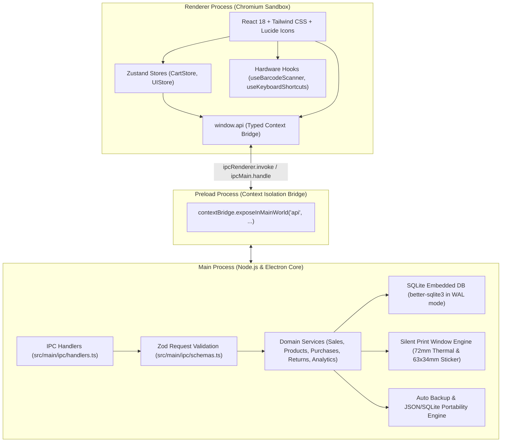

# KIDO 2628 Desktop POS & Inventory System
## AI Assistant & Architectural System Guide (AI_DOCUMENTATION.md)

> **Document Version:** 2.0.0  
> **Target Audience:** Autonomous AI Agents, LLM Coding Assistants, and Senior Core Engineers  
> **Last Verified:** November 2026  
> **Platform Support:** Windows 10/11 (NSIS & Portable) & macOS 12+ (Universal/Apple Silicon & Intel)

---

## 1. System Identity & Core Directives

**KIDO 2628 Retail App** is a mission-critical, offline-first Desktop Point of Sale (POS) and Multi-Variant Inventory Management system engineered specifically for children's fashion retail (`KIDO 2628 · 基多`, imported Korean kidswear).

### Foundational Invariants (Never Violate):
1. **Zero External Cloud Dependencies**: The system operates 100% locally and offline. No remote servers, telemetry, or third-party web backends may be introduced.
2. **Main-Process Data Isolation**: The embedded database (`better-sqlite3`) runs strictly in the Electron Main process. The renderer process **never** has direct disk, SQLite, or Node.js native access.
3. **Hardened Electron Sandbox Boundary**:
   - `contextIsolation: true`
   - `nodeIntegration: false`
   - `sandbox: true`
   - CSP header: `default-src 'self'` with inline SVG support.
   - External links must route through verified protocol checks (`http:`, `https:`) into `shell.openExternal`.
4. **Zod Validation on Every IPC Call**: All mutation requests crossing the IPC boundary must be parsed and sanitized with Zod schemas in the Main process before executing database logic.
5. **ACID Transactions for Inventory & Ledger Mutations**: Every sale, inward purchase, stock adjustment, return, and database restore must run inside an atomic `db.transaction(() => { ... })()` block.
6. **Financial Precision**: Never store or calculate money using floating-point accumulation without explicit monetary rounding (`Math.round((num + Number.EPSILON) * 100) / 100`).

---

## 2. Architecture & Process Boundary Model



---

## 3. Directory Layout & Module Responsibilities

```
kido2628/
├── .cursorrules                       # IDE & AI Assistant Instructions
├── electron.vite.config.ts            # Tri-process build config (Main, Preload, Renderer)
├── package.json                       # Dependencies, scripts, and electron-builder spec
├── tailwind.config.js                 # Theme styling and Tailwind CSS plugins
├── tsconfig.json                      # Base TypeScript config
├── tsconfig.node.json                 # Main & Preload TS compiler config
├── tsconfig.web.json                  # Renderer React TS compiler config
├── resources/                         # Application icon and static brand assets
│   ├── icon.png                       # Windows/Mac app icon
│   └── kido2628-brand.png             # Bilingual logo badge
├── src/
│   ├── main/                          # Electron Main Process (Node.js runtime)
│   │   ├── index.ts                   # Lifecycle, window management, security headers
│   │   ├── db/
│   │   │   ├── database.ts            # better-sqlite3 singleton with WAL & pragmas
│   │   │   ├── migrations.ts          # Sequential SQL schema migrations (v1, v2, v3)
│   │   │   └── schema.ts              # TypeScript interfaces for database records
│   │   ├── ipc/
│   │   │   ├── handlers.ts            # All ipcMain.handle dispatchers
│   │   │   └── schemas.ts             # Zod validation schemas for all write actions
│   │   ├── services/
│   │   │   ├── analytics.service.ts   # KPIs, register shifts, cash till reconciliation
│   │   │   ├── backup.service.ts      # Automated daily backups, JSON/SQLite import-export
│   │   │   ├── customers.service.ts   # CRM directory and lookup by mobile/name
│   │   │   ├── export.service.ts      # Sanitized Excel (.xlsx) and CSV exports
│   │   │   ├── inventory.service.ts   # Fast barcode intake, stock audit ledger, low-stock
│   │   │   ├── print.service.ts       # Hidden window silent ESC/POS & label print engine
│   │   │   ├── products.service.ts    # Multi-variant product catalog & matrix CRUD
│   │   │   ├── purchases.service.ts   # Supplier inward orders & weighted-average cost
│   │   │   ├── returns.service.ts     # Prorated invoice returns, restock & voiding
│   │   │   ├── sales.service.ts       # Atomic POS checkout, sequential INV-XXXX numbering
│   │   │   └── settings.service.ts    # Shop profile, printers list, low stock limits
│   │   └── __tests__/
│   │       └── verify-domain.ts       # 12 automated end-to-end domain verification tests
│   ├── preload/                       # Electron Preload Process
│   │   ├── index.ts                   # contextBridge exposure of window.api
│   │   └── index.d.ts                 # Type definitions augmenting Window interface
│   └── renderer/                      # Electron Renderer Process (React 18 + Vite)
│       ├── index.html                 # HTML entry with strict Content-Security-Policy
│       └── src/
│           ├── main.tsx               # React root bootstrap
│           ├── App.tsx                # Master frame, persistent navigation, active shift sync
│           ├── types/index.ts         # Frontend data contract mirror
│           ├── index.css              # Tailwind base, utilities, and font setup
│           ├── stores/
│           │   ├── cartStore.ts       # Zustand POS cart store (focus-preserving line edits)
│           │   └── uiStore.ts         # Active navigation page and toast notification queue
│           ├── hooks/
│           │   ├── useBarcodeScanner.ts # High-speed scanner buffer (<60ms keypress burst)
│           │   └── useKeyboardShortcuts.ts # Global F1-F8 keyboard navigation
│           ├── utils/
│           │   ├── barcode.ts         # Pure SVG Code-128 barcode generator (no canvas)
│           │   └── upi.ts             # Dynamic UPI BharatQR payload & QR code generator
│           ├── components/
│           │   ├── common/            # Modal, ToastContainer, Badges
│           │   ├── layout/            # Header, Sidebar, StatusBar
│           │   ├── pos/               # ScanBar, CartTable, SettlementPanel, Modals
│           │   └── products/          # Matrix Generator, LabelPrintModal, FastStockInModal
│           └── pages/
│               ├── PosPage.tsx        # F1: High-speed counter POS checkout
│               ├── ProductsPage.tsx   # F2: Multi-variant catalog and label printer
│               ├── ReportsPage.tsx    # F3: Net Sales, Net Profit KPIs and Excel export
│               ├── PurchasesPage.tsx  # F4: Supplier inward stock PO manager
│               ├── ReturnsPage.tsx    # F5: Invoice returns with restock toggles
│               ├── ShiftsPage.tsx     # F6: Cash till reconciliation & opening float
│               ├── SettingsPage.tsx   # F7: Shop details, hardware printers & backups
│               └── CustomersPage.tsx  # F8: CRM customer directory & purchase history
└── docs/                             # Dedicated developer & hardware documentation
    ├── AI_DOCUMENTATION.md            # This file
    ├── ARCHITECTURE.md                # System topology and component interaction
    ├── DATABASE_SCHEMA.md             # Complete SQLite ER diagram & table specs
    ├── HARDWARE_INTEGRATION.md        # ESC/POS 72mm & TSC/Zebra 63x34mm printer guide
    └── IPC_CONTRACTS.md               # Type-safe IPC API documentation
```

---

## 4. Database Architecture & Pragmas

### 4.1 SQLite Configuration
Database connection is managed by `better-sqlite3` in `src/main/db/database.ts`:
```ts
const db = new Database(resolvedPath);
db.pragma('foreign_keys = ON;');
db.pragma('journal_mode = WAL;');
db.pragma('synchronous = NORMAL;');
db.pragma('temp_store = MEMORY;');
```

- **WAL Mode (`Write-Ahead Logging`)**: Permits concurrent reads while a write transaction is executing.
- **Foreign Keys Enabled**: Strictly enforced across all child tables (`sale_items`, `purchase_items`, `return_items`, `stock_transactions`).
- **Sequential Migration Engine**: Versioned migrations stored in `schema_migrations` table. New migrations must increment integer version and execute inside `db.transaction()`.

### 4.2 Handling Backup Restoration
- **SQLite WAL Rule**: When replacing `kido2628.sqlite` with a binary backup, the `-wal` and `-shm` auxiliary files must be deleted or archived before reopening the connection to prevent SQLite from replaying stale journal frames over the restored file.
- **Foreign Keys During Bulk JSON Restore**: In SQLite, `PRAGMA foreign_keys = OFF;` must be called **outside** the transaction before bulk table truncation and restored in a `finally` block:
```ts
db.pragma('foreign_keys = OFF;');
try {
  return db.transaction(() => {
    // Truncate tables and bulk insert
  })();
} finally {
  db.pragma('foreign_keys = ON;');
}
```

---

## 5. Domain Invariants & Business Logic

### 5.1 Multi-Variant Catalog Hierarchy
- An article shares a master `sku` (e.g. `KD-JACKET-01`), `name`, `category`, `cost_price`, `markup_percent`, and `selling_price`.
- Variants (`product_variants`) hold size (`2Y, 3Y, 4Y`), colour (`Pink, Blue`), `opening_stock`, and `current_stock`.
- Unique constraint: `UNIQUE(product_id, size, color)`.

### 5.2 Atomic POS Checkout (`SalesService.create`)
1. **Validation**: Minimum 1 cart item. Tendered cash cannot be less than Grand Total when payment method is `Cash`.
2. **Sequential Invoice Generation**: `INV-${Math.max(1000, maxExisting) + 1}` using atomic query over `sales` table.
3. **Inventory Deduction**: Variant `current_stock` is atomically decremented.
4. **Audit Trail**: Every deduction logs a `SALE` entry into `stock_transactions`.
5. **Customer CRM Auto-Linking**: Customer mobile triggers `findOrCreate`, creating or updating the customer profile without manual CRM navigation.
6. **Open Shift Synchronization**: If a register shift is open, `total_cash_sales`, `gross_sales`, `net_sales`, and `expected_cash` are incremented.
7. **Silent Print**: Automatically dispatches receipt to configured thermal printer if designated in `settings`.

### 5.3 Return Proration & Invoice Refund Cap (`ReturnsService`)
1. **Bill Discount Proration**: If the original invoice had a bill-level discount, refund rates must be prorated:
   $$\text{billDiscountRatio} = \frac{\text{grandTotal}}{\text{subtotal}}$$
   $$\text{effectiveUnitPrice} = \operatorname{roundMoney}\left(\frac{\text{item.lineTotal}}{\text{quantity}} \times \text{billDiscountRatio}\right)$$
2. **Refund Cap**: Total refund across all returns on an invoice cannot exceed:
   $$\text{remainingInvoiceRefund} = \text{sale.grandTotal} - \sum \text{previousRefunds}$$
3. **Restock Toggle**:
   - If `restock === true`: variant `current_stock` is incremented and audit logged as `RETURN_RESTOCK`.
   - If `restock === false`: item is logged as `RETURN_DAMAGE` write-off with 0 stock increment.
4. **Shift Isolation**: The return stores `shift_id`. Voiding a return only restores cash to the till if the currently active open shift matches the return's original shift.

### 5.4 Cash Till Reconciliation (`AnalyticsService`)
- Shift opening captures `opening_float`.
- Expected cash is maintained in real-time:
  $$\text{expectedCash} = \text{openingFloat} + \text{cashSales} - \text{cashRefunds}$$
- Closing shift compares physical `countedCash` against `expectedCash`, computing `cashDifference` (Surplus, Balanced, or Deficit).

### 5.5 Weighted-Average Costing (`PurchasesService`)
When supplier purchase orders are inwarded:
$$\text{weightedCost} = \operatorname{roundMoney}\left(\frac{\text{oldCost} \times \text{totalCatalogStock} + \text{inwardCost} \times \text{inwardQty}}{\text{totalCatalogStock} + \text{inwardQty}}\right)$$

---

## 6. IPC Bridge & Security Architecture

### 6.1 Process Boundary Rules
- **No Node.js in Renderer**: Do not use `require`, `fs`, `path`, or `child_process` in `src/renderer`.
- **Exclusively Typed Bridge**: All IPC channels are exposed via `window.api.<namespace>.<method>` in `src/preload/index.ts`.
- **Main-Process Zod Schemas**: Validate every input object before passing to services.

### 6.2 Formula Injection Sanitization (CWE-1236)
In `src/main/services/export.service.ts`, cell values starting with `=, +, -, @, \t, \r` are prefixed with `'` to prevent Microsoft Excel formula execution upon file open, while preserving valid numeric strings (e.g. `-50.00`).

### 6.3 XSS Protection in Silent Print Templates
All values interpolated into HTML receipt or label templates must be escaped via `escapeHtml()` in `print.service.ts` and `barcode.ts`.

---

## 7. Keyboard Navigation & Hardware Integration

| Shortcut | Scope | Destination / Action |
| :--- | :--- | :--- |
| **`F1`** | Global / POS | Navigate to POS; if on POS, prompts to clear cart and start New Bill |
| **`F2`** | Global | Navigate to Products & Inventory |
| **`F3`** | Global | Navigate to Sales Register & Reports |
| **`F4`** | Global | Navigate to Supplier Inward Purchases |
| **`F5`** | Global | Navigate to Returns & Exchanges |
| **`F6`** | Global | Navigate to Register Shifts & Cash Till |
| **`F7`** | Global | Navigate to Settings & Backups |
| **`F8`** | Global | Navigate to Customer CRM Directory |
| **`Enter`** | POS Scan Bar | If SKU typed, adds item / opens variant picker; if empty, triggers Save & Print |
| **`Enter`** | Tender Input | Commits invoice and executes silent thermal receipt print |
| **`↑` / `↓`** | Variant Modal | Keyboard navigation across available sizes and colours |
| **`Esc`** | Modals | Closes any active modal dialog without committing |

### Hardware Barcode Scanner Buffer
Hardware USB/2.4G scanners emulate keystrokes. `useBarcodeScanner.ts` tracks keystroke burst intervals (<60ms). It automatically ignores input when modal dialogs are open unless focus is explicitly in a scan input.

---

## 8. Test Execution & Build Commands

```bash
# Type check both Node and Web contexts
npm run typecheck

# Run the 12-suite domain verification pipeline under Electron runtime
npm test

# Build production Vite bundles for Main, Preload, and Renderer
npm run build

# Package macOS installer (.dmg and unpacked .app)
npm run build:mac

# Package Windows installer (NSIS .exe and portable)
npm run build:win
```

> **Note on Native Addons**: `better-sqlite3` is compiled for Electron's Node ABI (`NODE_MODULE_VERSION 130`). Test and runner scripts must be invoked with `ELECTRON_RUN_AS_NODE=1 electron` rather than standalone Node.js.
