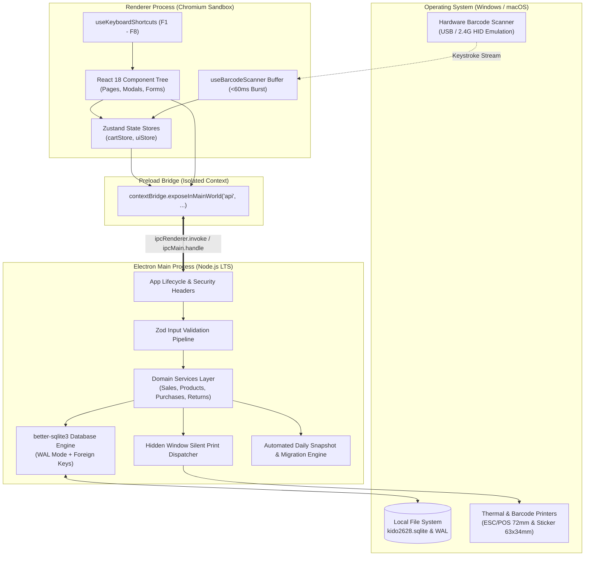

# KIDO 2628 Architecture & Technical Specifications

## 1. System Philosophy & Non-Negotiables

**KIDO 2628** is an offline-first, enterprise-grade retail desktop POS and inventory platform. It was rebuilt from the ground up to replace legacy browser-based `localStorage` limitations with a robust desktop architecture capable of processing thousands of invoices with sub-millisecond local query latencies.

### Architectural Principles:
1. **Offline Resilience**: The store operates without network dependency. All records, calculations, and printing occur locally.
2. **ACID Financial Integrity**: Every inventory deduction, refund, and shift reconciliation operates under transactional atomicity. Partial writes are impossible.
3. **Hardware Ergonomics**: Counter checkouts must be 100% keyboard-navigable, with hardware scanner burst buffering and silent thermal printing.
4. **Hardened Security**: The Electron application adheres to the principle of least privilege, preventing arbitrary code execution, XSS, and formula injection.

---

## 2. Process Boundary Architecture



---

## 3. Data & Persistence Layer

### 3.1 Embedded SQLite (`better-sqlite3`)
- **Location**: Electron `app.getPath('userData')/kido2628.sqlite`
- **Concurrency**: Write-Ahead Logging (`WAL`) allows concurrent reader processes while writes are committed in sequential transactions.
- **Constraints**: Foreign keys enabled on connection startup via `PRAGMA foreign_keys = ON;`.
- **Integrity**: Deletion of parent records is restricted when child records exist (`ON DELETE RESTRICT`) or cascades cleanly where appropriate (`ON DELETE CASCADE` on line items).

### 3.2 Sequential Migration System
Schema changes are version-controlled in `src/main/db/migrations.ts` and tracked in `schema_migrations`:
- **v1 (Initial Schema)**: 12 core tables (`settings`, `products`, `product_variants`, `customers`, `sales`, `sale_items`, `purchases`, `purchase_items`, `returns`, `return_items`, `stock_transactions`, `register_shifts`).
- **v2 (Default Settings Seed)**: Seeds default shop profile, phone numbers, and UPI configuration.
- **v3 (Return Shift Isolation)**: Adds `shift_id` to `returns` table to isolate cash till reconciliation.

---

## 4. State Management & Data Flow

### 4.1 Zustand POS Cart Store (`cartStore.ts`)
- **Focus Preservation**: Quantity and discount updates are performed in-memory without unmounting inputs, preventing input focus drop during rapid cashier edits.
- **Inline Discount Handling**: Line-item discounts are capped at line subtotal (`unitPrice * quantity`).
- **Bill-Level Discount**: Percentage or fixed rupee discount applied across grand total.
- **Real-Time Tender Math**: Automatically computes change due when cash tendered exceeds grand total.

### 4.2 Global UI Store (`uiStore.ts`)
- Manages active page navigation (`pos`, `products`, `reports`, `purchases`, `returns`, `customers`, `shifts`, `settings`).
- Queues toast notifications with auto-dismiss (3.5s timeout).

---

## 5. Security Architecture

1. **Chromium Sandbox**: Render process runs sandboxed without access to local disk, network sockets, or Node native APIs.
2. **Strict CSP**:
   ```
   default-src 'self'; script-src 'self' 'unsafe-inline'; style-src 'self' 'unsafe-inline'; img-src 'self' data: asset: file:; font-src 'self' data:; connect-src 'self' data:;
   ```
3. **Navigation Lockdown**:
   - `will-navigate`: Denies all navigations outside the Vite bundle root.
   - `setWindowOpenHandler`: Blocks window creation; validates external links strictly for `http:` and `https:` before opening via default OS browser.
   - `will-attach-webview`: Denies webview attachments.
4. **Formula Injection Defense (CWE-1236)**:
   - Excel and CSV exports sanitize cells starting with `=, +, -, @, \t, \r` by prepending `'`. Valid numeric values are preserved.
5. **XSS Escaping in Print Engine**:
   - Thermal receipt and label generators escape all user, product, and shop text using `escapeHtml()`.
