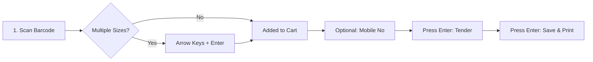

# KIDO 2628 · 基多 Cashier SOP & Counter Cheat Sheet
> **Quick-Reference Operational Guide for Cashiers & Store Staff**  
> *Print this sheet and keep it laminated beside the POS billing counter.*

---

## ⌨️ 1. Keyboard Shortcut Matrix

| Shortcut | Screen / Action | Purpose |
| :---: | :--- | :--- |
| **`F1`** | **POS Billing Counter** | Jump directly to New Sale / Clear Active Cart |
| **`F2`** | **Products & Inventory** | Search product catalog, manage variants, print barcode labels |
| **`F3`** | **Sales Register** | View past customer invoices, reprint thermal receipts |
| **`F4`** | **Purchases & Intake** | Inward supplier stock orders & fast scanner stock intake |
| **`F5`** | **Customer CRM** | Customer lookup, purchase history, contact directory |
| **`F6`** | **Register Shift** | **Morning Shift Open** (Float) & **Evening Close** (Cash Till) |
| **`F7`** | **Returns & Exchanges** | Verify invoice number, prorate discounts, process refunds |
| **`F8`** | **Settings & Backups** | Printer device configuration, store metadata, database backup |
| **`Enter`** | **Instant Save & Print** | In empty ScanBar or Tender panel: finalizes sale & prints silently |
| **`Esc`** | **Dismiss / Cancel** | Close open modals or exit current popover without saving |

---

## 🌅 2. Morning Routine: Opening the Cash Till (2 Minutes)

1. Turn on counter PC and thermal receipt printer.
2. Launch **KIDO 2628 Retail App**.
3. Press **`F6`** to open the **Register Shift** screen.
4. If a shift is not open, you will see a prompt to enter the **Opening Cash Float** (the physical petty cash/change kept in the cash drawer overnight, e.g., `₹1000.00`).
5. Type the float amount and click **Open Shift**.
6. Press **`F1`** to return to the POS counter. You are now ready to bill customers!

---

## 🛒 3. Standard POS Billing Flow (<30 Seconds per Customer)

### Step 1: Add Items to Cart
- **Barcode Scanner**: Point scanner at garment tag. The item is instantly added to the cart.
- **Multi-Variant Garments**: If an article shares one master barcode across sizes (`2Y`, `3Y`, `4Y`), the Variant Picker popup appears automatically:
  - Press **$\downarrow$ / $\uparrow$** to highlight the correct size/colour.
  - Press **`Enter`** to add it to the cart.
- **Quantity & Discounts**:
  - Click `+` or `-` to adjust quantity.
  - Optional item discount: enter discount amount in the item row.
  - Optional bill discount: enter percentage in the right-side summary.

### Step 2: Customer Details (Optional)
- Type customer mobile number or name in the Customer box.
- Existing customers auto-populate instantly.
- If skipped, bill defaults automatically to **Walk-in Customer**.

### Step 3: Tender & Payment
- Press **`Enter`** on the empty ScanBar to focus the **Settlement Panel**.
- Select payment method:
  - **Cash**: Enter amount tendered (e.g. ₹2000). The app displays exact **Change Due**.
  - **UPI**: Displays dynamic on-screen UPI QR code for the customer to scan on PhonePe / GPay / Paytm.
  - **Card**: Tap/Swipe on store card POS machine.
  - **Split**: Record combined cash + UPI/card payments.
- Press **`Enter`** or click **Save & Print (`F1` / `Enter`)**.
- The invoice commits atomically, the thermal receipt prints silently, and the cart resets for the next customer.

---

## 🔄 4. Returns & Exchanges Flow

1. Press **`F7`** to open **Returns & Exchanges**.
2. Enter the original **Invoice Number** (printed at the top of the receipt, e.g., `INV-1042`) and click **Verify**.
3. The screen loads the items purchased and the exact net rate paid (factoring in any bill-level discounts applied during the sale).
4. Select the garment being returned and specify the return quantity.
5. **Restock Toggle**:
   - Set to **Restock into Inventory** if the garment is in saleable condition.
   - Set to **Damaged / Write-Off** if defective (stock will not be added back).
6. Click **Process Return**.
7. Hand over the refund cash or adjust against an exchange purchase on `F1`.

---

## 🌙 5. Evening Routine: Closing Register & Till Reconciliation (3 Minutes)

1. After the last customer leaves, press **`F6`** (Register Shift).
2. Click **Close Shift**.
3. Count all physical cash notes and coins in the physical drawer.
4. Type the **Actual Counted Cash** in the prompt.
5. The system immediately calculates **Till Variance**:
   $$\text{Variance} = \text{Counted Cash} - (\text{Opening Float} + \text{Cash Sales} - \text{Cash Refunds})$$
   - `₹0.00` Variance: Drawer matches sales records 100%.
   - Negative: Cash shortage.
   - Positive: Cash excess.
6. Click **Confirm & Close Shift**. Print or note the EOD summary.
7. Close the app. The daily automated database snapshot executes automatically to `Documents/Kido2628_Backups/`.

---

## 🛠️ 6. Quick Counter Troubleshooting

| Issue | Immediate Solution |
| :--- | :--- |
| **Receipt printer doesn't print** | 1. Check if printer power LED is solid green and paper roll is full. 2. Press **`F8` (Settings)** and confirm the correct thermal printer is selected in the dropdown. 3. Click **Test Print Receipt**. |
| **Receipt prints blank white paper** | The thermal paper roll is upside down! Flip the roll so the heat-sensitive shiny coating faces the thermal print head. |
| **Barcode scanner doesn't beep** | Check USB cable connection. Ensure your mouse cursor isn't stuck outside the application window. |
| **Power outage / Counter PC restarted** | Simply re-open the app. SQLite WAL mode ensures **zero sales data loss**. The open shift remains active and will resume seamlessly. |
| **Price or stock discrepancy** | Press **`F2`**, search product code, verify variant stock count or update MRP. |

---
*KIDO 2628 Retail Management System · Offline-First Engine · Version 2.0*
