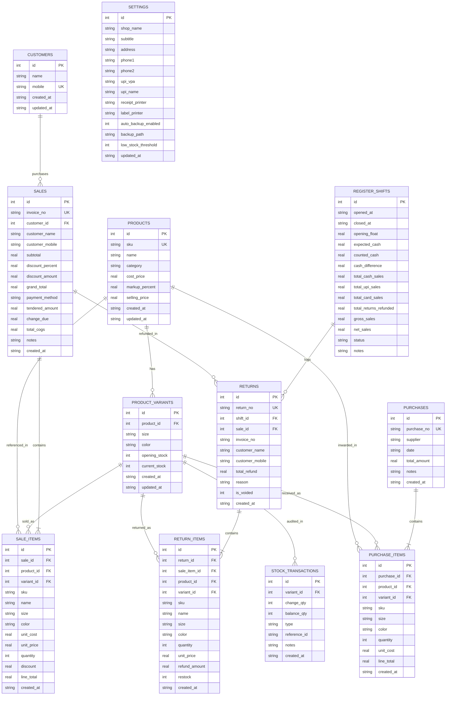

# KIDO 2628 Database Schema Specification

This document details the relational SQLite schema, foreign key relationships, indexes, and sequential migrations powering the KIDO 2628 retail desktop app.

---

## 1. Entity-Relationship Diagram (ERD)



---

## 2. Table Specifications

### 2.1 `products` (Article Master)
| Column | Type | Constraints | Description |
| :--- | :--- | :--- | :--- |
| `id` | `INTEGER` | `PRIMARY KEY AUTOINCREMENT` | Internal product ID |
| `sku` | `TEXT` | `NOT NULL UNIQUE COLLATE NOCASE` | Master Barcode / SKU |
| `name` | `TEXT` | `NOT NULL` | Product title |
| `category` | `TEXT` | `NOT NULL DEFAULT 'General'` | Category (`Boys`, `Girls`, `Newborn`) |
| `cost_price` | `REAL` | `NOT NULL DEFAULT 0.0` | Cost of goods (weighted average) |
| `markup_percent`| `REAL` | `NOT NULL DEFAULT 0.0` | Markup % on cost |
| `selling_price`| `REAL` | `NOT NULL DEFAULT 0.0` | Retail MRP |
| `created_at` | `TEXT` | `NOT NULL` | ISO 8601 creation timestamp |
| `updated_at` | `TEXT` | `NOT NULL` | ISO 8601 update timestamp |

### 2.2 `product_variants` (Size & Colour Matrix)
| Column | Type | Constraints | Description |
| :--- | :--- | :--- | :--- |
| `id` | `INTEGER` | `PRIMARY KEY AUTOINCREMENT` | Internal variant ID |
| `product_id` | `INTEGER` | `NOT NULL REFERENCES products(id) ON DELETE RESTRICT` | Parent product ID |
| `size` | `TEXT` | `NOT NULL DEFAULT ''` | Size label (`2Y`, `3Y`, `Free Size`) |
| `color` | `TEXT` | `NOT NULL DEFAULT ''` | Colour label (`Pink`, `Navy`) |
| `opening_stock`| `INTEGER` | `NOT NULL DEFAULT 0` | Initial opening quantity |
| `current_stock`| `INTEGER` | `NOT NULL DEFAULT 0` | Current real-time balance |
| `created_at` | `TEXT` | `NOT NULL` | Creation timestamp |
| `updated_at` | `TEXT` | `NOT NULL` | Last stock update timestamp |
| **Unique** | — | `UNIQUE(product_id, size, color)` | Prevents duplicate variant combos |

### 2.3 `sales` (Invoices)
| Column | Type | Constraints | Description |
| :--- | :--- | :--- | :--- |
| `id` | `INTEGER` | `PRIMARY KEY AUTOINCREMENT` | Internal invoice ID |
| `invoice_no` | `TEXT` | `NOT NULL UNIQUE` | Sequential invoice (`INV-1001`) |
| `customer_id` | `INTEGER` | `REFERENCES customers(id) ON DELETE SET NULL` | Linked customer CRM ID |
| `customer_name`| `TEXT` | `NULLABLE` | Customer name snapshot |
| `customer_mobile`| `TEXT` | `NULLABLE` | Customer phone snapshot |
| `subtotal` | `REAL` | `NOT NULL` | Sum of item line totals |
| `discount_percent`| `REAL`| `NOT NULL DEFAULT 0.0` | Bill-level percentage discount |
| `discount_amount`| `REAL` | `NOT NULL DEFAULT 0.0` | Bill-level rupee discount |
| `grand_total` | `REAL` | `NOT NULL` | Final payable amount |
| `payment_method`| `TEXT` | `NOT NULL` | `Cash`, `UPI`, `Card`, `Split` |
| `tendered_amount`| `REAL`| `NOT NULL DEFAULT 0.0` | Cash tendered by customer |
| `change_due` | `REAL` | `NOT NULL DEFAULT 0.0` | Change returned to customer |
| `total_cogs` | `REAL` | `NOT NULL DEFAULT 0.0` | Total cost of items sold |
| `notes` | `TEXT` | `NULLABLE` | Order remarks |
| `created_at` | `TEXT` | `NOT NULL` | Sale timestamp |

### 2.4 `returns` (Sales Returns & Exchanges)
| Column | Type | Constraints | Description |
| :--- | :--- | :--- | :--- |
| `id` | `INTEGER` | `PRIMARY KEY AUTOINCREMENT` | Internal return ID |
| `return_no` | `TEXT` | `NOT NULL UNIQUE` | Sequential return number (`RET-1001`) |
| `shift_id` | `INTEGER` | `REFERENCES register_shifts(id) ON DELETE SET NULL` | Active shift during return |
| `sale_id` | `INTEGER` | `REFERENCES sales(id) ON DELETE SET NULL` | Linked original sale ID |
| `invoice_no` | `TEXT` | `NOT NULL` | Original invoice number reference |
| `customer_name`| `TEXT` | `NULLABLE` | Customer name snapshot |
| `customer_mobile`| `TEXT` | `NULLABLE` | Customer phone snapshot |
| `total_refund` | `REAL` | `NOT NULL` | Total refund paid to customer |
| `reason` | `TEXT` | `NULLABLE` | Return reason |
| `is_voided` | `INTEGER` | `NOT NULL DEFAULT 0` | 1 if clerical error voided |
| `created_at` | `TEXT` | `NOT NULL` | Return timestamp |

---

## 3. Indexes & Performance Optimization

```sql
CREATE INDEX IF NOT EXISTS idx_products_sku ON products(sku);
CREATE INDEX IF NOT EXISTS idx_products_category ON products(category);
CREATE INDEX IF NOT EXISTS idx_variants_product ON product_variants(product_id);
CREATE INDEX IF NOT EXISTS idx_customers_mobile ON customers(mobile);
CREATE INDEX IF NOT EXISTS idx_customers_name ON customers(name);
CREATE INDEX IF NOT EXISTS idx_sales_invoice ON sales(invoice_no);
CREATE INDEX IF NOT EXISTS idx_sales_date ON sales(created_at);
CREATE INDEX IF NOT EXISTS idx_sale_items_sale ON sale_items(sale_id);
CREATE INDEX IF NOT EXISTS idx_sale_items_sku ON sale_items(sku);
CREATE INDEX IF NOT EXISTS idx_purchases_date ON purchases(date);
CREATE INDEX IF NOT EXISTS idx_purchases_supplier ON purchases(supplier);
CREATE INDEX IF NOT EXISTS idx_purchase_items_purchase ON purchase_items(purchase_id);
CREATE INDEX IF NOT EXISTS idx_returns_invoice ON returns(invoice_no);
CREATE INDEX IF NOT EXISTS idx_returns_date ON returns(created_at);
CREATE INDEX IF NOT EXISTS idx_returns_shift ON returns(shift_id);
CREATE INDEX IF NOT EXISTS idx_return_items_return ON return_items(return_id);
CREATE INDEX IF NOT EXISTS idx_stock_tx_variant ON stock_transactions(variant_id);
CREATE INDEX IF NOT EXISTS idx_stock_tx_date ON stock_transactions(created_at);
CREATE INDEX IF NOT EXISTS idx_shifts_status ON register_shifts(status);
```
